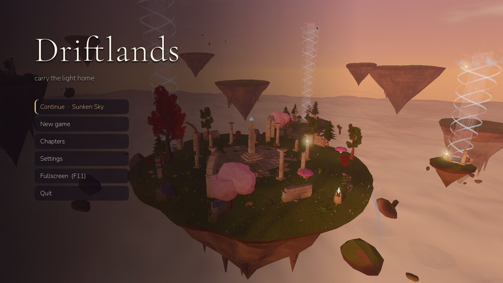
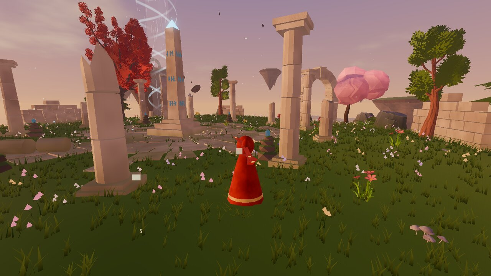
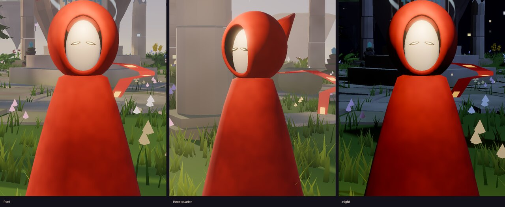
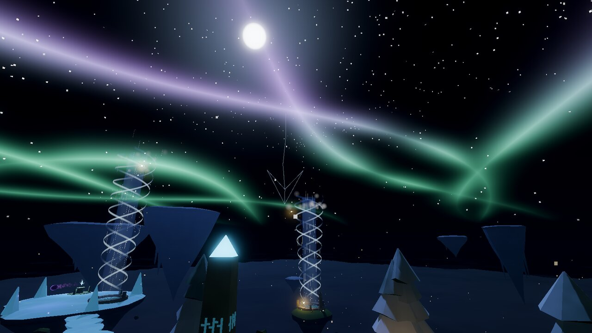
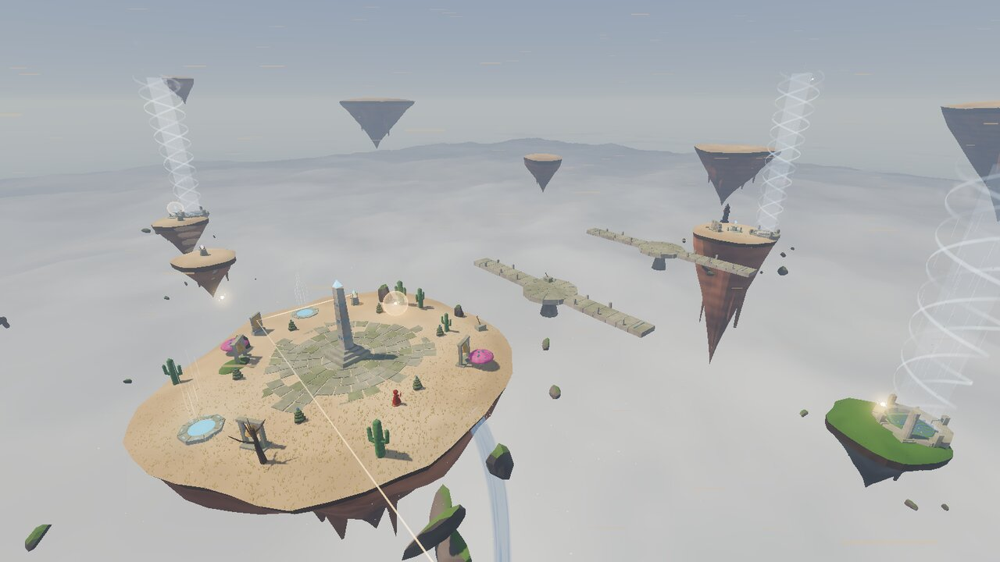
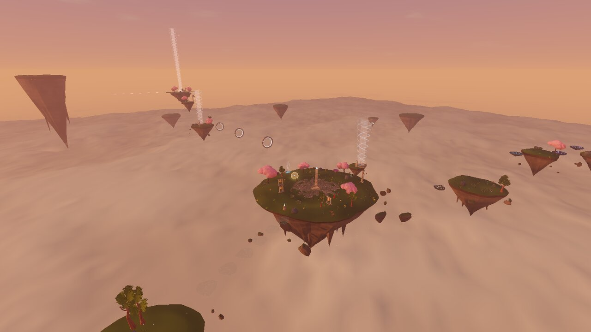

# Driftlands

*Carry the light home.*

Driftlands is a calm 3D exploration and glider game set on floating islands above a sea of clouds.
You play a small hooded wanderer who recovers lost light shards and returns them to each island's
beacon. To get around, you glide between islands, ride updrafts and solve light and stone puzzles.

Built with **Godot 4.7**. Every model is generated procedurally by headless **Blender** scripts and
every sound is synthesized in **Python**. The nature props are Quaternius' CC0 Stylized Nature MegaKit.



| | |
|---|---|
|  |  |
|  |  |



## Features

- **21 levels in three chapters**: *The Fading Light*, *The Far Reaches* and *The First Light*.
  Their biomes are meadow, ash, snow, desert, crystal and storm.
- **Glide-based traversal**: updrafts, boost rings, launch pads, gusts, mantling, bounce mushrooms,
  and moving, orbiting, crumbling and phasing platforms.
- **Beacon endings**: once the three shards are home, step into the beacon's light and rise out
  of the level. In each chapter finale the island collapses on a timer, and you have to ride the
  rings to an escape platform before it falls.
- **Carrying**: lift push stones and carry them (drop them by jumping), and bring heavy light
  orbs to the beacon by hand. A hit or a fall sends an orb back to its shrine.
- **Puzzles**: rotating mirrors and light beams, prism splits, pressure plates with push stones,
  sundials, resonance bells, levers with turning causeways, and night-sky constellations.
- **Threats**: wisps and sentinels you can block with a shield. Each level gives you hearts and lives.
- **Day/night cycle**: weather, aurora and storms with lightning, plus generative music that
  follows the mood of each level.
- **Per-level challenges and stars**: flawless runs, time targets and hidden fragments,
  with secret islands to find. Practice and Challenge modes are available.
- **Endless Flight and time trials**: an endless island chain that generates ahead of you,
  plus three trial courses with gold, silver and bronze times.
- **Difficulty** (Easy / Normal / Hard): changes lives, time goals, the fragment goal and enemy count.
- **Wardrobe**: unlock masks, scarves and robes with fragments, stars and completed levels.
- **Journal**: a carved lore stone near each beacon tells part of the story.
- **A living title screen**: the home island grows as you light beacons, and the wanderer roams it.
- **Touch controls** for playing in a mobile browser, detected automatically.
- **Photo mode**, three HUD layouts, rebindable keys, quality presets and autosave.

## Controls

| Action | Keys |
|---|---|
| Move | WASD / arrow keys |
| Jump / glide | Space (in the air) |
| Run / dive, sink in an updraft | Shift |
| Interact, lift / set down stones | E / F |
| Shield (hold) | Q / C |
| Return to safe ground | R |
| Photo mode | F2 |
| Pause | Esc / P |
| Fullscreen | F11 |

Use the mouse to steer the camera. Keys can be rebound in Settings.

**On phones and tablets** (in the browser, landscape), on-screen controls take over. Use the
floating stick on the left to move and drag anywhere else to look. The Jump / Glide, Run / Dive,
Shield and Use buttons sit on the right, and Pause and Return are on the left. The first tap goes
fullscreen. Settings → Gameplay → *Touch controls* switches them between Auto, On and Off.
On iPhone, use Share → *Add to Home Screen* to play without browser bars. Phones start on Low
quality with adaptive resolution, and the camera eases in behind you as you walk.

## Running

Open `project.godot` in Godot 4.7 and press Play, or play it in the browser:

```sh
tools/web.sh                  # exports the web build and serves it on http://localhost:4956
HOST=0.0.0.0 tools/web.sh     # same, reachable from a phone on your network (http://<pc-ip>:4956)
python3 tools/serve.py        # just serve the last export (no-cache headers, so refreshes pick up new builds)
```

## Development

```sh
# Regenerate models (headless Blender) and audio
blender -b -P tools/blender/build_assets.py -- assets/models [names...]
python3 tools/gen_audio.py

# Sanity-check a level headlessly
godot --headless -- --level=12 --audit
```

- Levels live in `scripts/levels/`. Levels 1–10 are hand-built; levels 11–21 use the route kit
  (`level_kit.gd`), which places islands from glide physics.
- Deferred ideas are tracked in [`docs/ROADMAP.md`](docs/ROADMAP.md).
